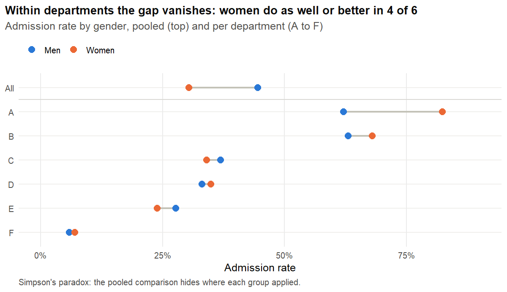
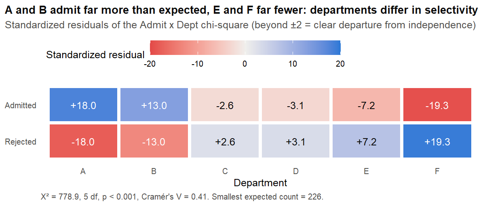
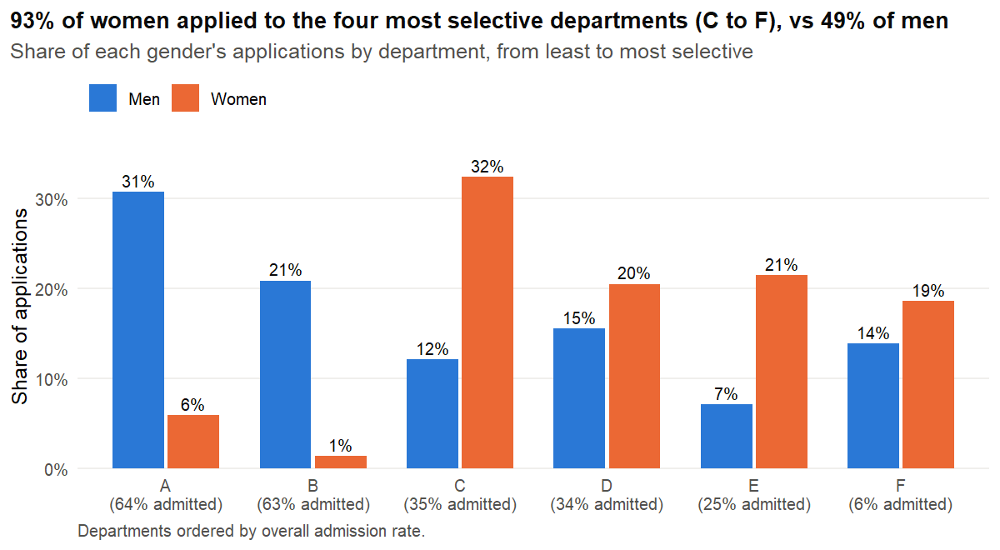

# Is our selection process biased? A fairness audit

> **Résumé (FR)**
> Question : le processus d'admission de UC Berkeley (1973) discrimine-t-il les femmes ?
> Données : table publique `UCBAdmissions`, 4 526 candidatures dans 6 départements.
> Méthode : comparaison des taux, Khi² avec résidus standardisés, test de Cochran-Mantel-Haenszel et régression logistique.
> Résultat : l'écart global de 14 points disparaît à département égal (odds ratio femmes/hommes 1,11, IC 95 % 0,94 à 1,30).
> Décision : le vrai sujet est l'orientation des candidates vers les départements les plus sélectifs, pas le jury.

[](https://github.com/AlexisYipmo/selection-fairness-audit/actions/workflows/ci.yml)

## Business question

An admissions office sees women admitted far less often than men. Before changing its selection rules, it needs to know: **is the committee biased against women, or does the gap come from somewhere else?** A wrong diagnosis leads to the wrong remedy.

## Answer in 3 numbers

| Metric | Value | What it means |
|---|---|---|
| Pooled admission gap, men minus women | **+14.2 points** (95% CI 11.3 to 17.0) | The headline number looks like discrimination |
| Odds ratio women vs men, controlling for department | **1.11** (95% CI 0.94 to 1.30, p = 0.23) | Within the same department, women are not disadvantaged |
| Share of applications sent to the four most selective departments | **93% of women vs 49% of men** | The gap comes from where people applied, not from how they were judged |

## Key visual



## Approach

1. **Data**: public `datasets::UCBAdmissions` table (Bickel et al., *Science*, 1975), 4,526 applications to the six largest departments. The total matches the original coursework file; a coding error in that file (244 rejections filed under the wrong department) is documented in [data/README.md](data/README.md).
2. **Pooled comparison**: admission rate by gender, two-sample test of proportions with a 95% confidence interval on the difference.
3. **Stratified view**: rates by department and gender, to expose Simpson's paradox.
4. **Admit x Dept dependence**: chi-square test with conditions checked on *expected* counts, Cramér's V as effect size, and standardized residuals to find which cells drive the dependence (replacing the coursework's invalid use of `cor()` on a contingency table).
5. **Adjusted gender effect**: Cochran-Mantel-Haenszel test and logistic regression `Admit ~ Gender + Dept` with odds ratios and 95% CIs, plus a likelihood-ratio test of the Gender x Dept interaction.

| File | Purpose |
|---|---|
| [notebooks/01_fairness_audit.qmd](notebooks/01_fairness_audit.qmd) | Full analysis, rendered to [docs/01_fairness_audit.html](docs/01_fairness_audit.html) |
| [src/fairness.R](src/fairness.R) | Reusable, unit-tested functions (rates, tests, models) |
| [tests/testthat/](tests/testthat/) | 17 unit tests on data integrity and statistics |

## Results

- **Pooled**: men 44.5% admitted, women 30.4% (chi-square = 91.6, 1 df, p < 0.001).
- **By department**: women have the higher admission rate in 4 of 6 departments (A, B, D, F). In department A, 82% of women are admitted against 62% of men.
- **Departments differ strongly in selectivity**: X² = 778.9, 5 df, p < 0.001, Cramér's V = 0.41. Departments A and B admit far more than expected under independence (standardized residuals +18.0 and +13.0), E and F far fewer (-7.2 and -19.3).
- **Application mix**: departments C to F admit between 6% and 35% of applicants and received 93% of women's applications, against 49% of men's.
- **Adjusted effect**: CMH common odds ratio women vs men = 1.11 (0.94 to 1.30); logistic regression gives the same estimate. Department odds ratios range from 0.04 to 0.96 relative to A: the department matters far more than gender.




## Limits & next steps

- **Limits**: aggregated observational data with no applicant qualifications, so the audit rules out a department-level gender gap but not bias upstream (how applicants are steered towards departments) or bias offset by stronger female applications. Six departments, one year, binary gender as recorded in 1973. The gender effect is not identical across departments (interaction p = 0.001, driven by department A), so the common odds ratio is an average.
- **Next steps**: ask why the most demanded departments admit so few (capacity or criteria), why women applied mostly to them, and whether funding follows demand; review department A separately; with individual-level data, add applicant qualifications to the model.

## How to run

Requires R 4.5 and [Quarto](https://quarto.org) 1.5 or later.

```bash
Rscript -e "install.packages('renv'); renv::restore()"
Rscript data/get_data.R
Rscript tests/testthat.R
quarto render notebooks/01_fairness_audit.qmd
```

Repository layout:

```
data/              get_data.R + README of sources (exported data is git-ignored)
notebooks/         01_fairness_audit.qmd
src/               fairness.R, reusable functions
reports/figures/   the four figures used in this README
tests/             testthat unit tests
docs/              rendered HTML report
```

## Author

**Alexis Yipmo**, senior data consultant (data engineering, BI, applied statistics), founder of DataOptime.
[LinkedIn](https://www.linkedin.com/in/alexisyipmo57265a12/) · [GitHub](https://github.com/AlexisYipmo)

Licensed under the [MIT License](LICENSE). Data: Bickel, Hammel & O'Connell (1975), shipped with R.
